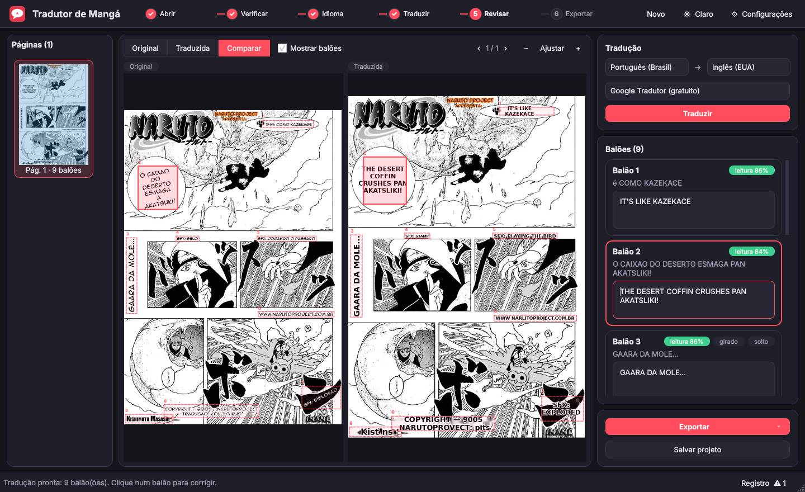

# Interface gráfica e executável (Windows)

## Abrir a interface sem gerar o executável

Na pasta `tradutor-manga`:

    pip install -r requirements.txt -r build\requirements-interface.txt
    python tradutor_gui.py

(ou `python -m manga_tradutor.interface`)

### Como usar a tela

1. **Abrir**: arraste o PDF, as imagens ou a pasta para a janela (ou use
   *Escolher arquivos* / *Escolher pasta*). As páginas entram em ordem natural
   (pag2 antes de pag10). *Abrir projeto salvo* continua um trabalho anterior.
2. **Verificar**: o programa confere cada página e a lista da esquerda mostra
   as que foram ignoradas por não parecerem mangá (passe o mouse para ver os
   motivos). Se nenhuma parecer, ele pergunta se deve traduzir mesmo assim.
3. **Idioma**: pergunta o idioma do mangá e o de destino (Português (Brasil),
   Inglês (EUA) ou Japonês).
4. **Traduzir**: lê os balões, traduz e escreve. A barra fina embaixo do
   cabeçalho mostra o andamento; *Cancelar* interrompe.
5. **Revisar**: *Original*, *Traduzida* ou *Comparar* lado a lado. Clique numa
   caixa da página para ir ao balão no painel da direita; corrija o texto e a
   página é redesenhada sozinha. Ctrl + roda do mouse dá zoom; PgUp/PgDn
   trocam de página. *Salvar projeto* (Ctrl+S) guarda tudo para continuar
   depois.
6. **Exportar**: PDF, CBZ (leitores de quadrinhos) ou PNG, sempre com o
   `textos.json` junto.

O idioma e o serviço de tradução também ficam no painel da direita, para
traduzir de novo. Em **Configurações** ficam as chaves de API do DeepL e do
Claude (sem chave, eles usam o Google Tradutor) e o tema claro ou escuro.
Avisos e detalhes de cada etapa ficam no botão **Registro**, no rodapé.

## Gerar o executável

Precisa de um computador **Windows** com Python 3.10 ou mais novo. O
PyInstaller não gera `.exe` a partir de Linux ou Mac.

1. Instale o Tesseract OCR (https://github.com/UB-Mannheim/tesseract/wiki) em
   `C:\Program Files\Tesseract-OCR`, marcando os idiomas Portuguese, English e
   Japanese (e Japanese vertical). Ele vai junto com o programa (só esses
   idiomas), então o usuário final não precisa instalar nada.
2. (Opcional) Instale o Inno Setup 6 (https://jrsoftware.org/isdl.php) para
   gerar também um instalador.
3. (Opcional) Rode o tradutor uma vez antes, para baixar os modelos na pasta
   `modelos`. Eles vão junto e o programa não precisa baixar nada na primeira
   vez que o usuário abrir.
4. Dê dois cliques em `build\gerar_exe.bat`.

Resultado:

- `build\dist\TradutorManga\TradutorManga.exe`: o programa. Para levar a outro
  computador, copie a pasta `TradutorManga` inteira (o `.exe` sozinho não
  funciona).
- `build\dist\TradutorManga-0.1.0-instalador.exe`: instalador com atalho no
  menu Iniciar e na área de trabalho (só se o Inno Setup estiver instalado).

### Por que "modo pasta" e não um `.exe` único

O `.exe` único do PyInstaller se descompacta numa pasta temporária a cada vez
que abre, o que deixa a abertura lenta (o Qt e o OpenCV são grandes) e faz
antivírus reclamarem com mais frequência. O modo pasta abre na hora, e o
instalador do Inno Setup entrega tudo num arquivo só para o usuário.

### Ajustes

- PyTorch (LaMa para apagar texto sobre o desenho e manga-ocr para japonês):
  fica de fora por padrão, porque deixa o programa várias centenas de MB maior. Sem ele
  o programa avisa e usa Tesseract e OpenCV. Para incluir:
  `pip install torch --index-url https://download.pytorch.org/whl/cpu manga-ocr`
  e depois `set INCLUIR_TORCH=1` antes de rodar o `.bat`.
- Tesseract em outra pasta: `set TESSERACT_DIR=D:\Tesseract-OCR` antes de
  rodar o `.bat`.
- Ícone: o `build\icone.ico` é usado no `.exe`; troque o arquivo para mudar.
- Versão do instalador: linha `#define Versao` em `build\instalador.iss`.
- Ver erros ao abrir o `.exe`: em `build\tradutor_manga.spec` troque
  `console=False` por `console=True` e gere de novo; as mensagens aparecem
  numa janela de terminal.

## Arquivos

| Arquivo | Para quê |
|---|---|
| `tradutor_gui.py` | ponto de entrada da interface |
| `manga_tradutor/interface/janela.py` | a janela (PySide6) |
| `manga_tradutor/interface/componentes.py` | peças da tela: área de soltar, etapas, visualizador, cartões |
| `manga_tradutor/interface/tema.py` | cores dos temas escuro e claro e o ícone |
| `manga_tradutor/interface/motor.py` | ponte entre a janela e o núcleo do tradutor |
| `build/tradutor_manga.spec` | receita do PyInstaller |
| `build/gerar_exe.bat` | instala dependências, gera o `.exe` e o instalador |
| `build/instalador.iss` | script do Inno Setup |
| `build/requirements-interface.txt` | PySide6 e PyInstaller |
